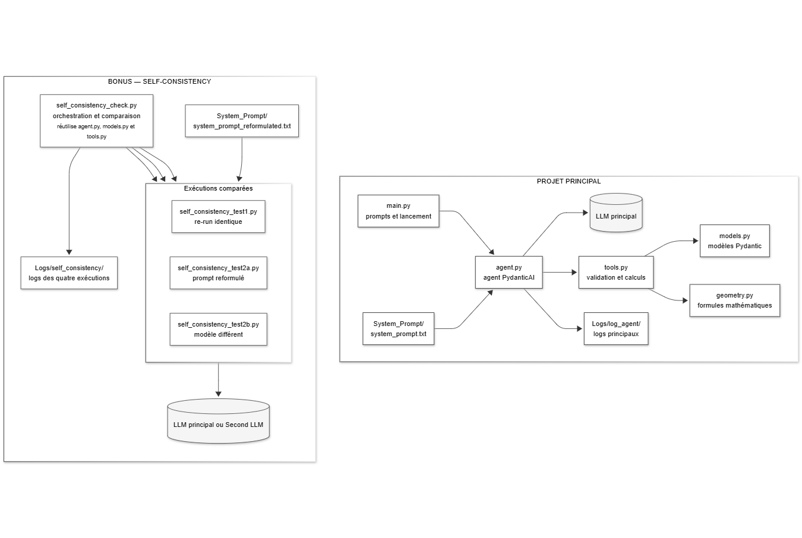
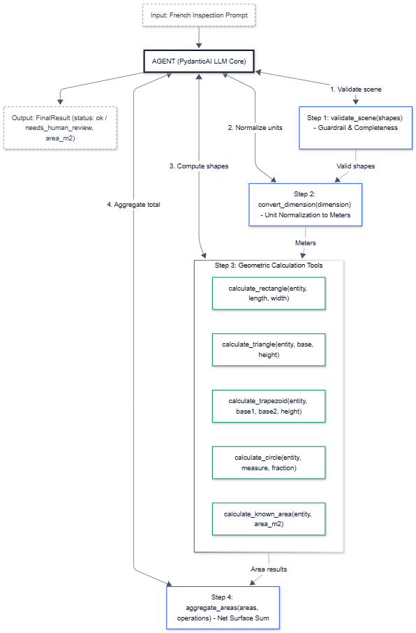

# AI Agent for Habitable Area Calculation

An LLM-powered agent that extracts geometric information from natural-language descriptions of a property and calculates its habitable area using deterministic Python tools.

## Features

- **Natural language understanding:** extracts shapes, dimensions, units, and area operations from French descriptions.
- **Structured validation:** uses Pydantic models to validate geometric data and detect ambiguities.
- **Deterministic calculations:** computes areas for rectangles, triangles, trapezoids, circles, and known surfaces.
- **Uncertainty handling:** flags incomplete or ambiguous inputs for human review instead of guessing.
- **Self-consistency checks:** compares repeated executions, a reformulated system prompt, and a second LLM to detect inconsistent results.

## Architecture

<p align="center">
  
</p>
<p align="center">
  <strong>Project file structure</strong>
</p>


- `main.py` — runs the main test scenarios.
- `agent.py` — configures the LLM, system prompt, and tools.
- `models.py` — defines the Pydantic data models and output schemas.
- `tools.py` — implements validation, unit conversion, geometric calculations, and area aggregation.
- `geometry.py` — contains deterministic geometry formulas.
- `self_consistency_check.py` — orchestrates self-consistency experiments and compares results.
- `self_consistency_test1.py` — tests repeatability with the same agent.
- `self_consistency_test2a.py` — tests sensitivity to system-prompt reformulation.
- `self_consistency_test2b.py` — tests consistency across different LLMs.

## Workflow

<p align="center">
  
</p>
<p align="center">
  <strong>End-to-end agent workflow</strong>
</p>


1. The LLM extracts geometric entities, dimensions, and operations from the description.
2. `validate_scene` checks whether the extracted data is sufficient for calculation.
3. Python tools calculate individual areas and aggregate additions and subtractions.
4. The agent returns a structured result containing the final area, warnings, and ambiguities.
5. Self-consistency checks compare the initial result against three control runs and flag significant disagreements for human review.

## Requirements

- `Python 3.12.6`
- `pydantic-ai 2.48.0`
- `pydantic 2.13.5`
- `python-dotenv`
- The provider dependencies required by the installed PydanticAI version for:
  - the main Mistral model: `mistral:ministral-14b-2512`;
  - the second model used by test 2B: `google:gemini-3.5-flash-lite`.
- API credentials: Add the required API keys to your .env file to run executions using Mistral and Google Gemini.


## Usage

Run the main scenarios:

```bash
python main.py
```

Run the self-consistency checks:

```bash
python self_consistency_check.py
```

The self-consistency checks use a tolerance of **0.1 m²**. If a significant disagreement is detected, the accepted result is marked `needs_human_review` and its area is set to `null`.

## Results

The agent was tested on three scenarios covering geometric calculations, area additions and subtractions, unit handling, and ambiguity detection.

### Case 1 — Trapezoidal Room

**Input:** La surface au sol de la cuisine est un trapèze de hauteur 753 cm, et bases 356 et 526. A cette surface il faut retrancher un triangle de 125x80 et un quart de cercle de rayon 80cm. Il faut également soustraire la surface de l'escalier de 3,76 et un dégagement de 0,7x1,2 pour obtenir la surface habitable.

```json
{
  "status": "ok",
  "area_m2": 27.604645175425638,
  "warnings": [],
  "ambiguities": []
}
```

### Case 2 — Bedroom with Uncertain Measurements

**Input:** La chambre fait 4,20 de long sur 3,10 de large. On ajoute une niche murale de 60 par 45. Il faut aussi soustraire un conduit de cheminée cylindrique de section 35 de diamètre. Il y a un arrondi dans l'angle nord-est qui réduit encore un peu la surface, mais je n'ai pas pu le relever précisément.

```json
{
  "status": "needs_human_review",
  "area_m2": null,
  "warnings": [
    "Le conduit de cheminée a été marqué pour soustraction mais nécessite une validation humaine pour confirmation."
  ],
  "ambiguities": [
    "La niche murale est explicitement mentionnée comme ajoutée, mais son inclusion dans la surface habitable est incertaine selon les normes.",
    "L'arrondi dans l'angle nord-est n'a pas de dimensions précises et ne peut pas être calculé."
  ]
}
```

### Case 3 — Living Room with Mixed Units

**Input:** Le salon fait 6 mètres de long et 450 de large. On retire un escalier en colimaçon de rayon 90 cm, ainsi qu'une trémie rectangulaire de 1,10 x 0,85. Le plombier a mesuré une partie du mur à 12 pouces mais je pense que c'est une erreur, ignore cette valeur si besoin. Enfin, ajoute la surface d'un bow-window en demi-cercle de rayon 1,5 m.

```json
{
  "status": "ok",
  "area_m2": 27.05,
  "warnings": [
    "mesure du mur à 12 pouces: mesure explicitement ignorée."
  ],
  "ambiguities": []
}
```

### Key Observations

- **Geometric calculations:** The agent computes areas and combines additions and subtractions.
- **Uncertainty handling:** Incomplete measurements and uncertain inclusions trigger human review instead of an unsupported final area.
- **Input interpretation:** Explicit instructions to ignore irrelevant measurements are reflected in the output.
- **Structured output:** Each result contains a status, an area when available, warnings, and ambiguities.


